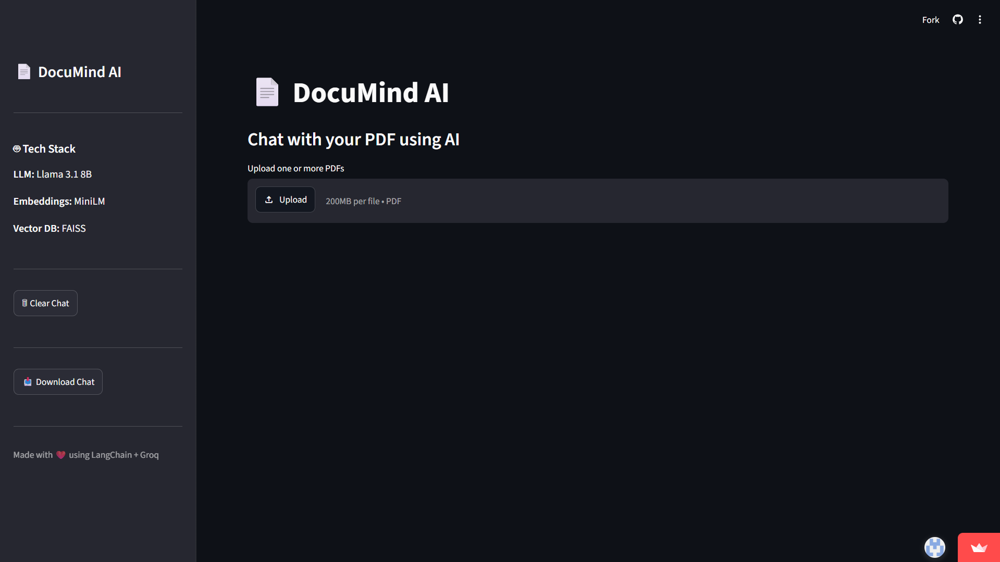
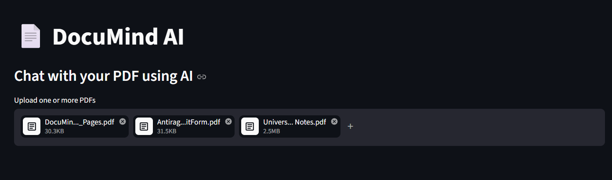
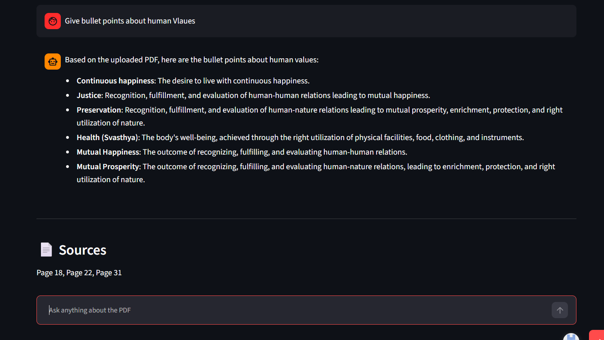
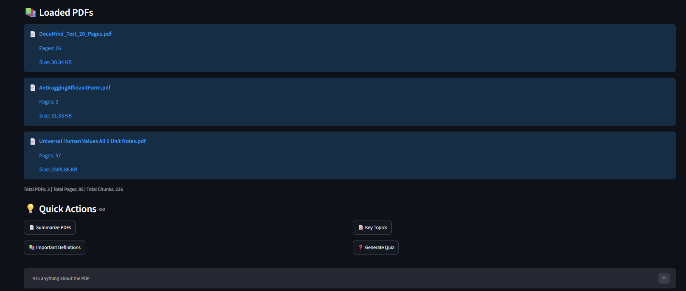

# 📄 DocuMind AI


An AI-powered Multi-PDF Question Answering application built using **LangChain**, **FAISS**, **Hugging Face Embeddings**, **Groq LLM**, and **Streamlit**.

Users can upload one or more PDF documents and ask natural language questions. The application uses **Retrieval-Augmented Generation (RAG)** to retrieve the most relevant content and generate accurate, context-aware answers with source page references.

---

## 🚀 Live Demo

🌐 https://tyagiinikunj-documind-ai-app-9tndmt.streamlit.app/

[](https://tyagiinikunj-documind-ai-app-9tndmt.streamlit.app/)

---

## ✨ Features

- 📚 Chat with multiple PDF documents
- 🤖 AI-powered Question Answering
- 💬 Context-aware follow-up conversations
- ⚡ Streaming AI responses
- 📄 Source page references
- 📝 PDF summarization
- 📌 Key topic extraction
- 📖 Important definition extraction
- ❓ Automatic quiz generation
- 📥 Download chat history
- 🗑 Clear chat functionality
- 🎨 Clean and responsive Streamlit interface

---

## 🛠 Tech Stack

| Category | Technologies |
|----------|--------------|
| Language | Python |
| Framework | Streamlit |
| LLM | Groq (Llama 3.1 8B Instant) |
| AI Framework | LangChain |
| Vector Database | FAISS |
| Embeddings | Hugging Face (MiniLM) |
| PDF Processing | PyPDF |
| Deployment | Streamlit Community Cloud |

---

## 🏗 Architecture

```text
User
   │
   ▼
Upload PDF(s)
   │
   ▼
PyPDF Loader
   │
   ▼
Text Splitter
   │
   ▼
MiniLM Embeddings
   │
   ▼
FAISS Vector Store
   │
   ▼
Retriever
   │
   ▼
Groq Llama 3.1
   │
   ▼
AI Response + Source Pages
```

---

## 📂 Project Structure

```text
DocuMind-AI/
│
├── utils/
│   ├── llm.py
│   ├── pdf_loader.py
│   ├── retriever.py
│   ├── text_splitter.py
│   └── vector_store.py
│
├── assets/
│   └── screenshots/
│
├── app.py
├── requirements.txt
├── .env.example
├── README.md
└── .gitignore
```

---

## ⚙️ Installation

Clone the repository

```bash
git clone https://github.com/tyagiinikunj/DocuMind-AI.git
```

Go to the project directory

```bash
cd DocuMind-AI
```

Install dependencies

```bash
pip install -r requirements.txt
```

Create a `.env` file

```env
GROQ_API_KEY=your_groq_api_key
```

Run the application

```bash
streamlit run app.py
```

---
## 📷 Screenshots

### 🏠 Home Page


---

### 📚 Multiple PDF Upload



---

### 💬 AI Question Answering



---

### ❓ Quiz Generation & Quick Actions




---

## 🔮 Future Improvements

- OCR support for scanned PDFs
- Highlight answer inside PDF
- Multiple LLM selection
- User authentication
- Persistent chat history
- Cloud vector database
- Document management dashboard

---

## 👨‍💻 Author

**Nikunj Tyagi**

- GitHub: https://github.com/tyagiinikunj
- LinkedIn: *(Add your LinkedIn profile URL here)*

---

## 📄 License

This project is licensed under the MIT License.

---

## ⭐ Support

If you found this project useful, consider giving it a ⭐ on GitHub!